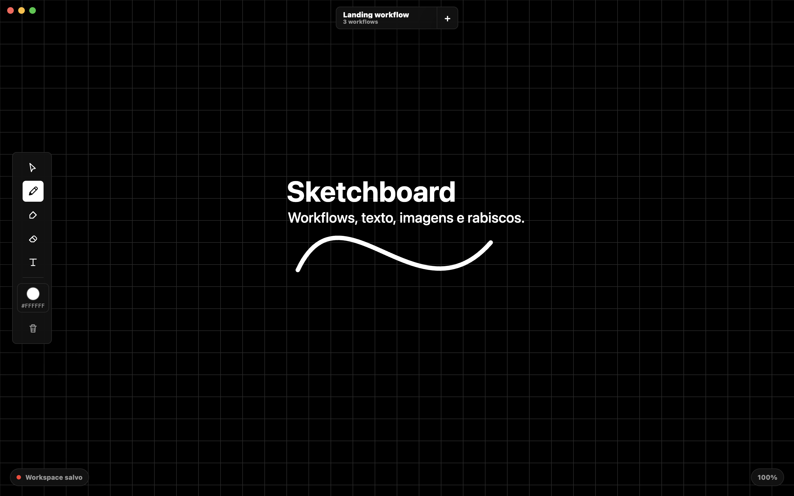

# Sketchboard

Sketchboard is a clean Electron whiteboard for drawing, placing images, editing text and organizing multiple workflow boards.



## Features

- Multiple workflow boards in the same workspace.
- Pencil, marker, eraser and text tools.
- Brush thickness and smoothing controls.
- Image paste, drag-and-drop and object manipulation.
- Auto-save workspace state.
- Export/import workflow configuration with `.sketchboard.json` files.

## Download

Grab the latest installer from the [Releases](https://github.com/kaikynetto/sketchboard/releases) page:

| OS | File |
|---|---|
| macOS (Apple Silicon) | `Sketchboard-<version>-mac-arm64.dmg` |
| macOS (Intel) | `Sketchboard-<version>-mac-x64.dmg` |
| Windows | `Sketchboard-<version>-win-x64.exe` |
| Linux | `Sketchboard-<version>-linux-x86_64.AppImage` or `Sketchboard-<version>-linux-amd64.deb` |

Each release includes `SHA256SUMS.txt` so you can verify downloads.

## Run locally

```bash
npm install
npm start
```

## Build installers

```bash
npm run dist:mac
npm run dist:win
npm run dist:linux
```

Generated installers are saved in `dist/`. Installers are not code signed. See [CONTRIBUTING.md](CONTRIBUTING.md) for releases.

## Workflow backup

Use the workflow menu inside the app to export all workflows to a `.sketchboard.json` file and import them later into another workspace.

## Contributing

Contributions are welcome. Read [CONTRIBUTING.md](CONTRIBUTING.md) and the [Code of Conduct](CODE_OF_CONDUCT.md) first.

## License

[MIT](LICENSE) © Kaiky Netto and Raphael Xavier
